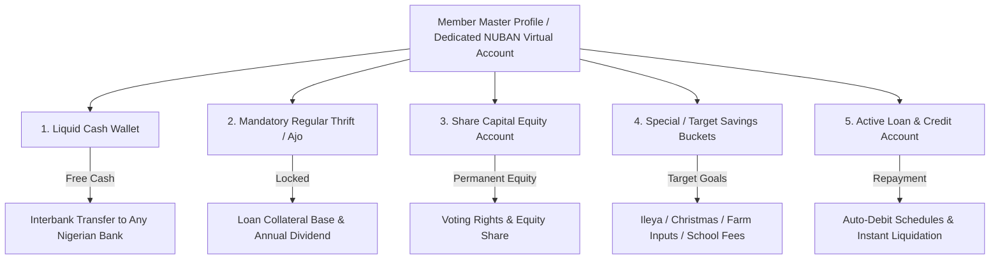
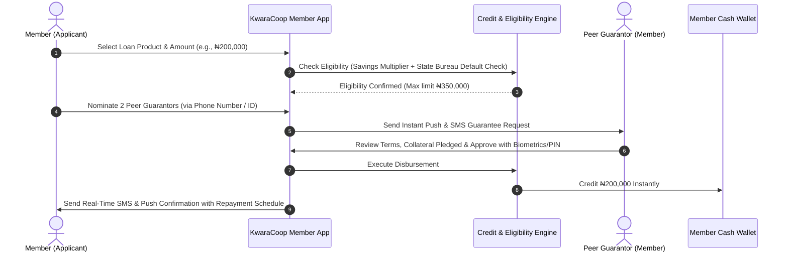

# KwaraCoop: Member-Centric Core Digital Banking Specification

## 1. Overview & Vision: Member as the Primary Beneficiary

In traditional cooperative models, members often experience "opaque accounting"—they contribute blind monthly deductions without instant visibility, wait weeks for loan approvals, and lack modern digital banking perks. 

**KwaraCoop** flips the paradigm: **Every member receives a full-fledged Cooperative Digital Bank Account.** The platform delivers enterprise-grade retail banking directly into the hands of civil servants in Ilorin, farmers in Patigi and Edu, and market traders across Kwara State.

---

## 2. Member Multi-Bucket Digital Account Topology

Each member is provisioned a master profile linked to a dedicated **10-Digit NUBAN Virtual Account Number** (powered by NIBSS BaaS integration with a partner bank such as Providus, Wema, or Sterling Bank). Under this master account, the system isolates multiple specialized sub-accounts:



### Account Breakdown
| Sub-Account | Purpose | Liquidity | Earning Potential |
|---|---|---|---|
| **Liquid Cash Wallet** | Day-to-day transactional funds; deposit and withdraw anytime. | High (Instant interbank transfer out) | 0% - Nominal interest |
| **Mandatory Regular Thrift** | Core monthly savings requirement; serves as loan collateral. | Locked (Withdrawable only upon exit) | Primary driver for annual dividend payouts |
| **Share Capital Account** | Member's permanent equity stake in the cooperative society. | Fixed Equity | Generates dividends on shares |
| **Special / Target Savings** | Custom member-defined goal buckets (e.g., Farm Seedlings, School Fees, Hajj/Pilgrimage). | Flexible or Time-Locked | Higher yield / rebate incentives |
| **Loan Account** | Displays active principal, interest, amortization schedule, and late penalties. | Credit facility | Decreases as member repays |

---

## 3. Core Banking Services & Transaction Capabilities

### A. Dedicated NUBAN Virtual Account (Instant Inbound Funding)
- Each member is assigned a personal NUBAN (e.g., `KwaraCoop / Providus Bank - 9912345678`).
- **Any bank transfer** made from GTBank, FirstBank, OPay, PalmPay, or Kuda directly to this NUBAN automatically credits the member's Liquid Wallet within 3 seconds.
- **Kwara State Payroll Auto-Deductions:** For civil servants and teachers, the system interfaces with Kwara State payroll (Ministry of Finance), automatically distributing monthly payroll deductions into their Regular Thrift and active loan repayments.

### B. Outbound Transfers & Bill Payments
- **Interbank Transfer (NIP):** Transfer money from the Liquid Wallet to any commercial bank account in Nigeria with biometric/PIN authorization.
- **Internal Peer-to-Peer (P2P):** Send funds fee-free to any other cooperative member across Kwara using just their phone number or Member ID.
- **Utility & Airtime Bill Payments:** Buy airtime, data, and pay electricity bills (IBEDC - Ibadan Electricity Distribution Company serving Kwara) directly from wallet balances.

---

## 4. Savings Management & "Target Savings" Engine

Members have full self-service control over how they save:

1. **Automated Standing Orders (Debit Card / Direct Debit):**
   - Members can connect their debit cards (Mastercard, Visa, Verve) to set recurring daily, weekly, or monthly automated savings (e.g., ₦1,000 every market day).
2. **Goal-Based Special Savings ("Ajo Target"):**
   - Members can create customizable target savings vaults:
     - *Ileya / Eid-el-Kabir Ram Fund*
     - *Farming Season Input Fund (Fertilizers & Seeds)*
     - *Children's School Fees Vault*
     - *Emergency Rainy-Day Bucket*
3. **Automated Locking & Discipline Rules:**
   - Members can lock a target savings vault until a specific date. 
   - Early liquidation carries a configurable forfeiture penalty to incentivize fiscal discipline.
4. **Interest & Dividend Accrual Tracker:**
   - Daily interest accrual visible in the mobile app, showing real-time growth of savings balances.

---

## 5. Intelligent Loan Origination & Automated Repayment



### Key Loan Lifecycle Capabilities
1. **Instant Eligibility Calculator:**
   - Automatically determines borrowing capacity (e.g., up to 200% or 300% of accumulated thrift and share capital).
   - Zero collateral needed beyond the member's savings and trusted peer guarantors.
2. **Digital Peer-Guarantor Workflow:**
   - Eliminates physical paper guarantee forms.
   - Guarantors receive an instant in-app notification displaying the borrower's risk history, loan purpose, and the exact portion of their own savings being encumbered.
3. **Flexible Repayment Channels:**
   - **Auto-Sweep:** Automatic deduction from the member's wallet on the agreed due date.
   - **One-Click Top-Up Repayment:** Member can click "Pay Now" using card, bank transfer, or liquid wallet funds.
   - **Early Repayment Rebate:** Automated interest discount applied if a loan is liquidated ahead of term.

---

## 6. Real-Time Multi-Channel Alert & Notification Pipeline

Every single movement of funds triggers real-time alerts across multiple channels to guarantee trust and transparency:

```
[Transaction Event Trigger]
        │
        ├─► In-App Push Notification (Rich receipt with transaction breakdown)
        ├─► Instant SMS Alert (For both smartphone and feature phone users)
        ├─► WhatsApp Chatbot Notification (Interactive PDF receipt download)
        └─► Email Statement Dispatch (Comprehensive transaction advisory)
```

### Event Types Triggering Immediate Alerts:
1. **Payroll / Contribution Credit:** *"Your monthly deduction of ₦15,000 has been credited to your Mandatory Thrift. Current balance: ₦185,000."*
2. **Daily Field Collector Debit/Credit:** *"Agent Abdulrahman received ₦2,000 at Mandate Market for your Daily Ajo. Token ID: #KW-8819. Current balance: ₦42,000."*
3. **Loan Repayment Due Warning:** Sent 5 days, 2 days, and on the morning of repayment due date.
4. **Guarantor Request & Release:** Alerts when nominated as a guarantor, and instant notification when the borrower finishes repaying, releasing the guarantor's encumbered funds.
5. **Annual Dividend Distribution:** Celebratory alert detailing total dividend on shares and patronage refund credited into their wallet.

---

## 7. Grassroots & Feature-Phone Inclusivity (USSD Core Banking)

For farmers, elderly members, or rural artisans without smartphones or 4G data in areas like Kaiama, Baruten, Edu, and Patigi:

### USSD Flow (`*384*24#` KwaraCoop Gateway)
```
Welcome to KwaraCoop Mobile Banking
1. Check Balances (Wallet / Thrift / Special)
2. Mini Statement (Last 5 transactions via SMS)
3. Transfer / Withdraw
4. Special Savings Deposit
5. Loan Services (Apply / Check Status / Repay)
6. Guarantor Approvals
0. Exit
```

- **SMS-to-Passbook:** After every USSD transaction, an SMS mini-receipt is dispatched free of charge to the member's phone.
- **Field Agent Micro-POS:** Society field agents carry solar-rechargeable handheld Bluetooth thermal printers to issue paper receipts in rural markets alongside SMS confirmations.

---

## 8. Security, Privacy & Compliance (NDPR / CBN Standards)

1. **Biometric & Transaction PIN:** 
   - 4-digit Transaction PIN required for every outbound movement of money.
   - Fingerprint / Face ID biometric login on iOS and Android.
2. **Account Freezes & Self-Service Limits:**
   - Member can set daily spending/transfer limits.
   - Instant "Panic Button" to freeze wallet if their phone or card is misplaced.
3. **Audited Double-Entry Ledger:**
   - All financial operations enforce strict double-entry balance sheets where `Assets = Liabilities + Equity`.
   - Immutable audit logs guarantee that neither society executives nor software admins can alter historical ledger entries.
