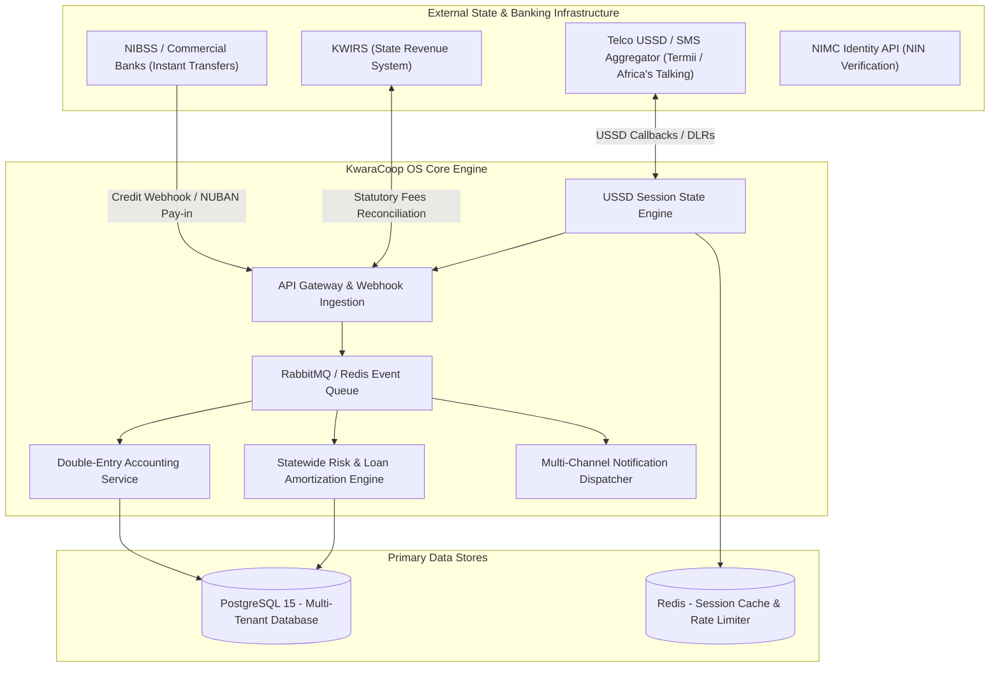
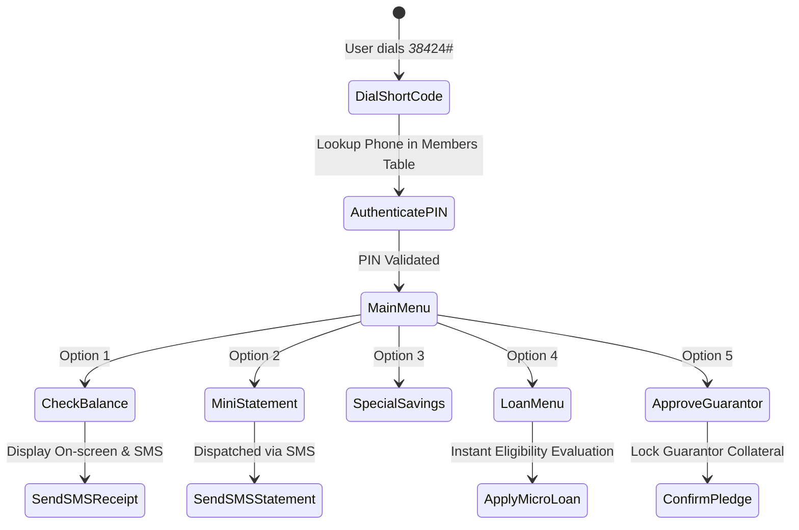

# KwaraCoop OS: Technical Implementation & Integration Guide

This guide details the backend services, event-driven ledger processing, external banking integrations (NIBSS / BaaS), USSD session management, and API specifications for **KwaraCoop OS**.

---

## 1. System Integration Architecture



---

## 2. Inbound Virtual NUBAN Webhook Handler (Core Banking Pay-In)

When a member transfers money from any commercial bank (FirstBank, GTB, OPay) to their dedicated 10-digit NUBAN, the BaaS partner (e.g. Providus / Monnify) fires a signed HTTP `POST` webhook.

### Execution Workflow:
1. **Signature Verification:** Verify HMAC-SHA512 header using the shared secret.
2. **Idempotency Check:** Verify `transaction_reference` has not been processed.
3. **Double-Entry Journal Posting:**
   - **DEBIT:** `Society Settlement Bank Asset Account`
   - **CREDIT:** `Member Liquid Cash Wallet Liability Account`
4. **Target Allocation Check:** If the member has an active auto-save rule (e.g., 50% to "Ileya Ram Vault"), automatically execute the sub-ledger transfer.
5. **Real-time Alert Dispatch:** Push an SMS and WhatsApp alert to the member within <3 seconds.

### Node.js / TypeScript Webhook Processing Logic:
```typescript
import { Request, Response } from 'express';
import crypto from 'crypto';
import { db } from './db';
import { notificationQueue } from './queues';

export async function handleInboundNubanWebhook(req: Request, res: Response) {
  const signature = req.headers['x-webhook-signature'] as string;
  const rawBody = JSON.stringify(req.body);

  // 1. Validate cryptographic signature
  const expectedHash = crypto
    .createHmac('sha512', process.env.BANK_WEBHOOK_SECRET!)
    .update(rawBody)
    .digest('hex');

  if (signature !== expectedHash) {
    return res.status(401).json({ error: 'Invalid signature' });
  }

  const { event, data } = req.body;
  if (event !== 'charge.completed' || data.status !== 'success') {
    return res.status(200).send('Event acknowledged');
  }

  const {
    account_number, // Member's 10-digit NUBAN
    amount,          // e.g. 25000.00
    transaction_ref, // Unique external ID
    sender_name,
    sender_bank
  } = data;

  // 2. Execute within an ACID Database Transaction
  const result = await db.transaction(async (trx) => {
    // Check idempotency
    const existing = await trx('journal_entries').where({ reference_number: transaction_ref }).first();
    if (existing) return { alreadyProcessed: true };

    // Find member by NUBAN
    const vAccount = await trx('member_virtual_accounts')
      .where({ nuban_account_number: account_number })
      .first();

    if (!vAccount) throw new Error('Unassigned NUBAN account');

    const member = await trx('members').where({ id: vAccount.member_id }).first();
    const liquidAccount = await trx('ledger_accounts')
      .where({ member_id: member.id, account_type: 'Liquid_Wallet' })
      .first();

    const controlAssetAccount = await trx('ledger_accounts')
      .where({ society_id: member.society_id, account_name: 'Settlement_Bank_Account' })
      .first();

    // 3. Create Journal Entry
    const [journal] = await trx('journal_entries').insert({
      society_id: member.society_id,
      reference_number: transaction_ref,
      narration: `NUBAN Deposit from ${sender_name} (${sender_bank})`,
      channel: 'Bank_Transfer_NUBAN',
      initiated_by_member_id: member.id
    }).returning('*');

    // 4. Double-Entry Posting: Debit Bank Asset, Credit Member Liability
    await trx('ledger_postings').insert([
      {
        journal_entry_id: journal.id,
        account_id: controlAssetAccount.id,
        debit_amount: amount,
        credit_amount: 0,
        balance_after: controlAssetAccount.current_balance + amount
      },
      {
        journal_entry_id: journal.id,
        account_id: liquidAccount.id,
        debit_amount: 0,
        credit_amount: amount,
        balance_after: liquidAccount.current_balance + amount
      }
    ]);

    // Update Account Balances
    await trx('ledger_accounts').where({ id: liquidAccount.id }).increment('current_balance', amount);
    await trx('ledger_accounts').where({ id: controlAssetAccount.id }).increment('current_balance', amount);

    return { member, newBalance: liquidAccount.current_balance + amount, amount };
  });

  // 5. Trigger Instant Real-time SMS Alert
  if (!result.alreadyProcessed) {
    await notificationQueue.add('sendSMS', {
      to: result.member.phone_number,
      message: `Credit: NGN ${result.amount.toLocaleString()} received via NUBAN Transfer. New Cash Wallet Bal: NGN ${result.newBalance.toLocaleString()}. KwaraCoop Ref: ${transaction_ref.substring(0, 10)}.`
    });
  }

  return res.status(200).json({ status: 'success' });
}
```

---

## 3. USSD Session State Machine (`*384*24#`)

To ensure rural accessibility across Patigi, Edu, Kaiama, and Baruten:



---

## 4. Loan Repayment Auto-Sweep Engine (Nightly Reconciliation Cron)

A resilient worker runs at 04:00 AM WAT to process upcoming amortization installments:

1. **Query Due Installments:** Fetch all `loan_repayment_schedules` where `due_date <= CURRENT_DATE` and `is_paid = false`.
2. **Attempt Liquid Wallet Auto-Sweep:** Check if borrower's `Liquid_Wallet` balance $\ge$ installment due.
3. **If Funds Sufficient:** Execute double-entry debit against member wallet and credit to `Loan_Receivable`, mark schedule paid, and dispatch SMS confirmation.
4. **If Funds Insufficient:**
   - Deduct available partial balance.
   - Dispatch friendly reminder alert: *"Loan installment for facility #LN-904 is due today. Please fund your NUBAN account 9920148291 to avoid penalty."*
   - Escalate to guarantor notification if unpaid after 14-day grace period.

---

## 5. Core API Endpoints

### Member Banking Endpoints
| Endpoint | Method | Description |
|---|---|---|
| `/api/v1/member/account` | `GET` | Fetches member profile, NUBAN, and all sub-account balances. |
| `/api/v1/member/transfer` | `POST` | Initiates interbank or P2P transfer with PIN authorization. |
| `/api/v1/member/savings/vault` | `POST` | Creates a new Target/Special Savings bucket with lock parameters. |
| `/api/v1/member/loans/eligible` | `GET` | Computes maximum borrowing limit and tenure tiers based on savings. |
| `/api/v1/member/loans/apply` | `POST` | Submits loan application and dispatches peer guarantor approval alerts. |
| `/api/v1/member/loans/guarantee/respond` | `POST` | Peer guarantor approves or declines a loan guarantee request. |

### Ministry Supervisory Endpoints
| Endpoint | Method | Description |
|---|---|---|
| `/api/v1/ministry/societies` | `GET` | Filterable list of all registered societies across the 16 LGAs. |
| `/api/v1/ministry/credit-registry/search`| `GET` | Queries statewide anti-loan-stacking database by NIN or BVN. |
| `/api/v1/ministry/audits/queue` | `GET` | Lists pending annual returns and statutory compliance filings. |
| `/api/v1/ministry/interventions/allocate`| `POST` | Dispatches government agricultural inputs/grants to verified societies. |
