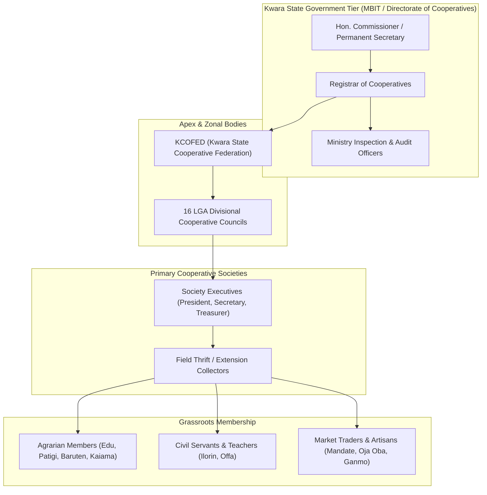
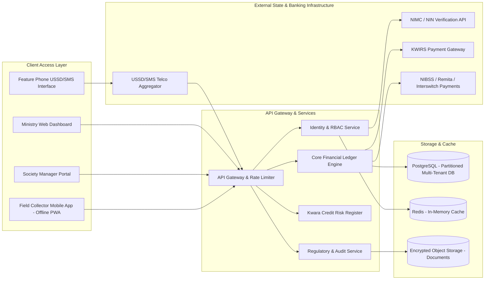

# KwaraCoop OS: Kwara State Cooperative Management & Regulatory Information System
**Software Architecture, System Design & Operational Blueprint**

---

## 1. Executive Summary & Vision

In Kwara State, cooperative societies (CTCS, Farmers' Cooperatives, Artisans, and Multipurpose Societies) drive the local micro-economy across all 16 Local Government Areas (LGAs). However, the existing ecosystem faces structural bottlenecks:
- Fragmented paper ledgers and bookkeeping errors.
- Lack of regulatory visibility for the **Kwara State Ministry of Business, Innovation & Technology (MBIT)** / Directorate of Cooperatives.
- Loan defaults and multi-society borrowing ("loan stacking").
- Difficulties distributing and tracking targeted agricultural and micro-credit interventions (e.g., via KWASSIP and State Agricultural Support).

**KwaraCoop OS** is conceived as a **dual-tier, multi-tenant digital ecosystem**:
1. **The State Ministry Regulatory & Supervision Portal:** A state-wide dashboard for registration, licensing, compliance audits, financial health scoring, and intervention fund disbursement.
2. **The Cooperative Society Operations App (Web, Mobile & USSD):** An end-to-end management tool handling daily thrift collections (*Esusu/Ajo*), monthly share contributions, loan origination, dividend calculations, and inventory of subsidized farming inputs.

---

## 2. Multi-Tier Stakeholder Hierarchy

---

## 3. Core Functional Modules

### A. Ministry Regulatory & Supervision Portal (G2B / G2C)
1. **Digital Registry & e-Certificate Issuance:**
   - Formal digitized onboarding for new cooperative societies.
   - Generation of unique, tamper-proof **Kwara Cooperative Registration IDs (KCR-ID)** with embedded verification QR codes.
   - Automated annual statutory renewal and fee collections (integrated with **KWIRS - Kwara State Internal Revenue Service**).
2. **Statutory Annual Returns & e-Audit:**
   - Standardized chart of accounts submission for annual audits.
   - Algorithmic Liquidity & Capital Adequacy ratio monitoring to flag distressed societies early.
3. **Statewide Cooperative Credit Bureau:**
   - Centralized risk register linking members by National Identity Number (NIN) or BVN to detect and prevent predatory multi-society loan defaulting.
4. **Intervention & Grant Distribution Engine:**
   - Transparent routing and verification of state/federal agricultural inputs (seeds, tractors, fertilizers) and cash micro-grants (e.g., KWASSIP) directly to verified society members.
5. **GIS & LGA Analytical Dashboard:**
   - Heatmap of cooperative distribution, savings volume, and default rates across the 3 Senatorial Districts (Kwara Central, Kwara South, Kwara North) and 16 LGAs.

---

### B. Cooperative Society Management Portal (Day-to-Day Operations)
1. **Membership Management & Digital Passbook:**
   - Digital KYC profile: biometric capture, NIN validation, next-of-kin, and membership tiering.
   - Real-time digital passbook displaying accumulated thrift, shares, and special savings.
2. **Savings & Thrift Collection (Esusu / Regular Contributions):**
   - Support for daily, weekly, and monthly deduction schedules.
   - Field collection module for roaming agents with instant SMS receipts to members.
3. **End-to-End Loan Lifecycle Management:**
   - Loan application submission against member's collateralized share capital.
   - Guarantor approval system (digitally verified by peer members).
   - Automated amortization schedules, interest recalculations, and penalty assessments for late payments.
4. **Dividends & Patronage Rebate Calculator:**
   - Automated formula-driven calculation of dividends on share capital and patronage refunds at the close of financial years.
5. **Agro-Commodity & Store Inventory:**
   - For agricultural cooperatives: tracking bulk purchase of farm inputs, tractor hire slots, produce buy-back, and storage warehousing in rural outposts.

---

### C. Member Access Channels (Grassroots Inclusion)
- **Smartphone App & Progressive Web App (PWA):** For urban civil servants, teachers, and business owners in Ilorin, Offa, and Omu-Aran.
- **USSD & SMS Gateway:** Dialing an offline USSD shortcode (e.g., `*384*24#`) allowing rural farmers and market women to check balances, confirm daily collection payments, and request emergency micro-loans.
- **Multilingual Support:** Interface and SMS alerts localized in **English, Yoruba, Nupe, and Bariba**.

---

## 4. Technical Architecture

### Key Technical Attributes
- **Architecture:** Microservices-ready Modular Monolith using NestJS (Node.js/TypeScript) or Go, with a responsive React/Next.js frontend.
- **Database:** PostgreSQL with Row-Level Security (RLS) guaranteeing strict tenant isolation between separate cooperatives.
- **Offline-First Synchronization:** The mobile app for field officers in remote areas (such as Baruten, Kaiama, or Patigi with intermittent connectivity) caches transactions locally with SQLite/WatermelonDB and reconciles via cryptographic batch signatures upon internet recovery.
- **Security & Compliance:** 
  - NDPR (Nigeria Data Protection Regulation) compliance.
  - Immutable audit logs for all financial entries (double-entry bookkeeping principles enforced at the database level).

---

## 5. Phased Implementation Roadmap

| Phase | Milestone | Focus Areas | Timeline |
|---|---|---|---|
| **Phase 1: Pilot & Digitization** | Ministry Registry & Pilot Rollout | Deploy Ministry regulatory portal; digitize 50 prominent cooperatives in Ilorin West, Ilorin South, and Offa; establish KCR-ID registry. | Months 1 – 3 |
| **Phase 2: Core Operations** | Day-to-Day Financial Modules | Onboard thrift collections, loan workflows, financial ledgers, and USSD integration with telecommunications providers. | Months 4 – 6 |
| **Phase 3: Rural Expansion** | Agrarian & North Senatorial District | Rollout of offline field collection apps to farming cooperatives in Edu, Patigi, Kaiama, and Baruten; farm input tracking. | Months 7 – 9 |
| **Phase 4: Full State Integration** | State Interventions & Credit Bureau | Activation of statewide credit blacklist registry; integration with KWASSIP and KWIRS for all statutory returns and state agricultural interventions. | Months 10 – 12 |

---

## 6. Success Metrics & Value Creation for Kwara State

1. **For the State Government:**
   - Total transparency into cooperative asset values across the state.
   - Elimination of ghost beneficiaries in government agricultural subsidy programs.
   - Increased non-tax revenue generation through seamless statutory annual registration and renewal via KWIRS.
2. **For Cooperative Societies:**
   - Drastic reduction in bookkeeping fraud and manual paperwork.
   - Streamlined year-end financial statement preparation and instant audit sign-offs.
3. **For Citizens & Members:**
   - Instant proof of thrift savings via automated SMS/app alerts.
   - Protection of hard-earned savings through state-backed regulatory oversight.
