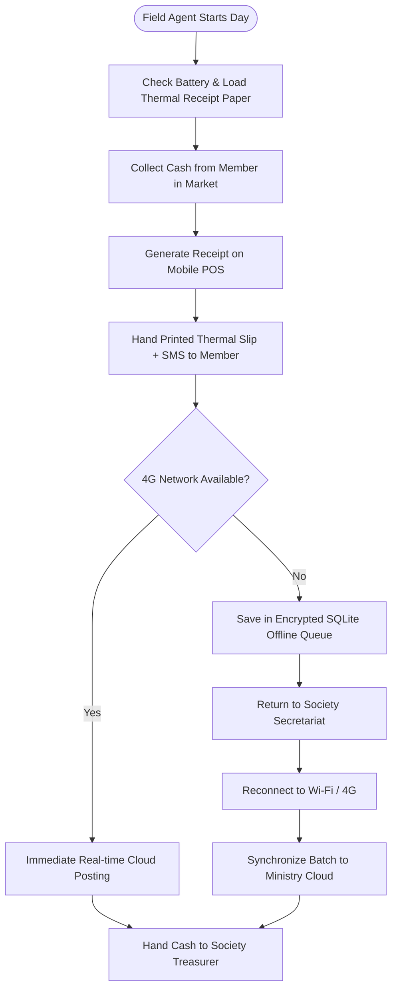

# KwaraCoop OS: Standard Operating Procedures (SOP) & Field Operations Manual

**Directorate of Cooperative Societies**  
*Ministry of Business, Innovation and Technology, Kwara State*

---

## 1. Scope & Objective
This manual establishes the mandatory operational guidelines, compliance rules, and dispute resolution workflows governing all cooperative societies operating within the 16 Local Government Areas of Kwara State under **KwaraCoop OS**.

---

## 2. Ministry Regulatory & Inspection Protocols

### A. Annual e-Audit & License Renewal (Mandatory Timeline)
1. **Filing Window:** Every registered society must submit its audited financial returns via the Society Admin Portal between **January 1st and March 31st** annually.
2. **Statutory Fee Verification:** Renewal filings are locked until the **KWIRS** payment transaction reference is verified by the automated gateway.
3. **Automated Risk Scoring (Red-Flag Triggers):**
   - **Liquidity Ratio < 20%:** The system automatically dispatches a Zonal Field Inspector to examine bank reconciliation statements.
   - **Loan Default Rate > 5%:** Automatic freeze on new loan originations until the Society Board submits an executive recovery plan.
   - **Overdue Audit > 60 Days:** Generation of a formal 14-day statutory warning notice signed by the Chief Registrar of Cooperatives.

### B. Statewide Credit Risk Registry Enforcement
- Under no circumstances shall a Society President or Treasurer disburse a loan to any applicant flagged by the system as **"Active Default"** in another society in Kwara State.
- Any society that circumvents this check by disbursing off-platform unrecorded cash forfeits state agricultural subsidy allocations for 24 months.

---

## 3. Society Executive Governance Protocols

### A. Daily Cash Vault Reconciliation (Treasurer SOP)
1. When field agents return from markets (e.g. Mandate, Oja-Oba, Ganmo, Offa), the Treasurer must:
   - Count physical cash in the presence of the collector.
   - Compare cash against the **Encrypted POS Batch Hash** generated on the mobile app.
   - Execute the digital "Confirm Vault Remittance" sign-off in the portal.
2. All cash exceeding ₦100,000 must be deposited into the society’s commercial settlement bank account within **24 hours**.

### B. Loan Origination & Peer-Guarantor Approvals
1. **Collateral Threshold:** Maximum loan eligibility shall not exceed **200% of accumulated savings** (Thrift + Share Capital).
2. **Guarantor Enforceability:**
   - Every loan requires a minimum of **2 peer guarantors**.
   - The system locks the guaranteed portion of each guarantor's savings as unwithdrawable collateral until the loan is fully repaid.
   - If a borrower defaults for 90 days, the system executes an automated recovery sweep against the guarantors' encumbered thrift balances after formal notification.

### C. Annual General Meeting (AGM) Surplus Distribution
1. In accordance with Kwara State Cooperative Law, net surplus must be partitioned as follows:
   - **25% Minimum:** Retained in the Society Statutory Reserve Fund.
   - **5% Maximum:** Allocated to the Cooperative Education & Community Development Fund.
   - **70% Maximum:** Distributed to active members as Dividends on Share Capital and Patronage Rebates on loan interest paid.

---

## 4. Field Agent Operations (Rural & Offline Collections)

### Key Field Rules:
- **No Cash Without Paper Slip:** An agent must never accept cash without immediately generating and handing over a printed thermal receipt bearing the unique `#KWCP` transaction hash.
- **Battery & Thermal Roll Management:** Field agents deployed to agrarian outposts (e.g. Patigi rice farming clusters or Kaiama yam markets) must carry fully charged battery packs.
- **Zero Offline Retention Beyond 24 Hours:** All transactions queued offline must be synchronized to the central server within 24 hours of creation.

---

## 5. Member Rights & Protection Standards

1. **Right to Instant Digital Statement:** Every member is entitled to a real-time digital passbook displaying their savings, shares, and loan amortization without paying administrative statement fees.
2. **Right to Free SMS Receipts:** All contributions and deductions must be confirmed via free SMS within 3 seconds of cloud posting.
3. **Dispute Resolution Mechanism:**
   - If a member notices an unauthorized deduction, they can activate the **"Dispute Transaction"** button in their mobile app or dial `*384*24#` (Option 8).
   - This places a temporary hold on the transaction and escalates it to the Zonal Cooperative Inspector in their LGA for arbitration.

---

*Approved by Order of:*  
**Chief Registrar of Cooperatives**  
Directorate of Cooperative Societies  
Ministry of Business, Innovation and Technology  
Kwara State Government, Nigeria
